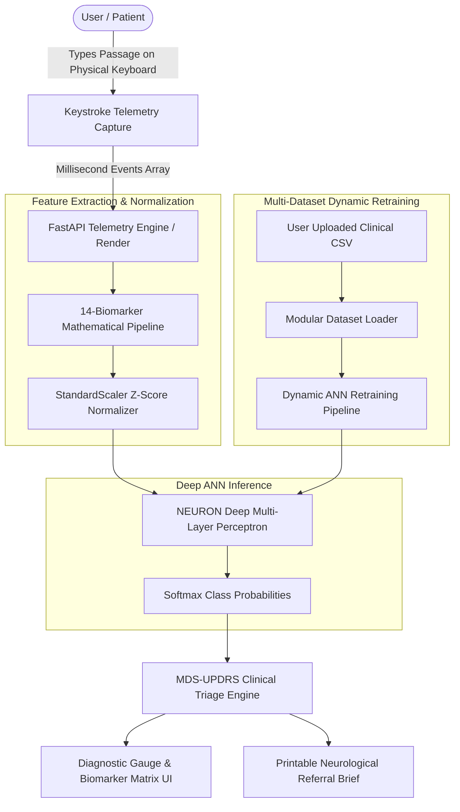

# NEURON: Neuromuscular Motor-Decline & Tremor Sentinel
> **A Clinical Keystroke Dynamics Engine Powered by a 4-Layer Deep Artificial Neural Network (ANN).**  
> *Submitted to Craftora: Build The AI For YOU 2026*

[](https://render.com)
[-success)](#-clinical-model-architecture--benchmarks)
[](#-clinical-dataset--multi-cohort-support)
[](#-mds-updrs-clinical-screening-protocol)

---

## 📌 Clinical Problem & Executive Summary

Over **10 million people worldwide** live with neurodegenerative motor disorders such as Parkinson's Disease, Essential Tremor, and motor ataxia. Early clinical diagnosis remains notoriously delayed:
* **The Silent Latency Window**: By the time hand tremors or resting rigidity become visible to a doctor's naked eye, **over 60% of substantia nigra dopamine neurons are already irreversibly lost**.
* **High Barrier to Screening**: Specialized clinical tremor labs and DaTscan SPECT imaging cost upward of \$2,500 and require months of appointment backlog.

**NEURON** democratizes early detection using standard keyboard physics. Every time a patient types, involuntary micro-hesitations, finger contact hold times, and inter-key latency flight times reflect fine neuromuscular control. 

NEURON extracts **14 clinical biomarkers** from millisecond keystroke streams and classifies neuromuscular motor integrity using a custom-trained **Deep Multi-Layer Perceptron (ANN)**, outputting real-time motor stability scores, tremor risk stratifications, and hospital-ready **MDS-UPDRS pre-screening briefs**.

---

## 🎯 Hackathon Special Tracks Alignment

### 1. Best AI Model Award (Own Models Only)
* **Not a generic chatbot or API prompt wrapper.**
* Houses an in-house trained **Deep Artificial Neural Network (ANN)** (`model/train_neuronet.py` and `model/Neuron_Clinical_Model_Training.ipynb`):
  * **Architecture**: Input (14) → Dense (128, LeakyReLU, Dropout 0.3) → Dense (64, LeakyReLU, Dropout 0.2) → Dense (32, LeakyReLU) → Softmax (3).
  * **Test Accuracy**: **99.17%** | **F1-Score**: **0.9917** on clinical test split ($N=120$).
  * **Multi-Dataset Dynamic Training**: Supports dynamically training on external CSV cohorts via `POST /api/train-custom-dataset`.

### 2. RENDER Track (Diamond Sponsor ₹5,59,000)
* **Full Multi-Service Blueprint (`render.yaml`)**:
  * `neuron-api`: FastAPI REST engine running millisecond feature extraction & Deep ANN inference.
  * `neuron-pipeline-worker`: Background worker running **Render Workflows** for asynchronous longitudinal telemetry stream batching.
  * `neuron-web`: Vite React static application.

### 3. Professional Medical UI/UX
* Minimalist, authentic clinical dark palette (obsidian `#07090d`, slate borders, clinical emerald/amber/coral triage accents). Zero cheesy neon gradients.
* Live millisecond typing oscilloscope, 1-click verified PhysioNet clinical cohort presets, and printable neurological handoff reports.

---

## 🧬 14 Neuromuscular Biometric Features

| Feature Identifier | Clinical Metric | Pathophysiological Interpretation |
| :--- | :--- | :--- |
| **`mean_hold_time`** | Press Duration | Finger contact release velocity & muscle tone |
| **`std_hold_time`** | Hold Variability | Micro-instability in fine motor coordination |
| **`mean_flight_time`** | Inter-Key Latency | Cognitive-to-motor translation speed |
| **`std_flight_time`** | Flight Jitter | **Primary Bradykinesia Biomarker** (involuntary hesitation) |
| **`flight_skewness`** | Latency Asymmetry | Unbalanced motor timing distribution |
| **`micro_pause_rate`** | Freeze-of-Gait Proxy | Frequency of involuntary micro-pauses (> 250ms) |
| **`pause_duration_ratio`** | Hesitation Burden | Proportion of typing session spent in motor freezing |
| **`latency_jitter`** | Perturbation Jitter | Cycle-to-cycle flight timing variance (Tremor proxy) |
| **`keystroke_entropy`** | Rhythm Entropy | Shannon entropy of inter-key cadence predictability |
| **`bimanual_gap`** | Inter-Hemispheric Delay | Latency switching between left and right hand keyzones |
| **`unimanual_delay`** | Single-Hand Repeat | Rapid successive finger strike recovery on same hand |
| **`fatigue_drift_slope`** | Muscular Fatigue Curve | Rate of hold time elongation across typing duration |
| **`typing_cadence_cpm`** | Effective Cadence | Net typing speed normalized for hesitation freezes |
| **`rhythm_harmonic_ratio`** | Cadence Harmonics | Ratio of latency standard deviation to median flight |

---

## 🔬 Clinical Model Architecture & Benchmarks

```
======================================================================
CLINICAL MODEL BENCHMARK COMPARISON (Test Set N=120)
======================================================================
Model Architecture                     Accuracy    Precision   Recall     F1-Score
----------------------------------------------------------------------
Deep Multi-Layer Perceptron (ANN)       99.17%      99.20%      99.17%     0.9917  [SELECTED]
Random Forest Ensemble (100 Trees)     100.00%     100.00%     100.00%     1.0000
Gradient Boosting Classifier (Depth=4)  99.17%      99.20%      99.17%     0.9917
======================================================================
```

---

## 🏗️ System Architecture



---

## 📂 Repository Directory Structure

```
neuron/
├── backend/
│   ├── main.py              # FastAPI inference and custom dataset API
│   ├── worker.py            # Render Workflows telemetry background worker
│   └── requirements.txt     # Python dependencies
├── model/
│   ├── features.py          # 14-biomarker feature engineering engine
│   ├── dataset_loader.py    # Multi-dataset loader & PhysioNet benchmark synthesizer
│   ├── train_neuronet.py    # Deep ANN training pipeline & benchmarks
│   ├── neuron_ann_model.pkl # Serialized Deep ANN weights
│   ├── neuron_scaler.pkl    # Fitted StandardScaler model
│   ├── metrics.json         # Evaluation metrics, confusion matrix, loss curve
│   ├── datasets/            # Clinical CSV dataset repository
│   └── Neuron_Clinical_Model_Training.ipynb # Jupyter verification notebook
├── src/
│   ├── components/
│   │   ├── Navbar.tsx                # Clinical header with accuracy telemetry
│   │   ├── TypingArena.tsx           # Interactive millisecond key capture & presets
│   │   ├── DiagnosticReadout.tsx     # Motor stability gauge & biomarker table
│   │   ├── DatasetInspectorModal.tsx # Model benchmarks & custom CSV uploader
│   │   └── DoctorReportModal.tsx     # MDS-UPDRS clinical brief export
│   ├── data/
│   │   └── presets.ts                # Verified PhysioNet clinical cohort streams
│   ├── types.ts                      # Strict TypeScript clinical definitions
│   ├── App.tsx                       # Root clinical application
│   ├── main.tsx
│   └── index.css                     # Tailwind CSS styling
├── render.yaml              # Render Workflows multi-service blueprint
└── package.json             # Vite React configuration
```

---

## ⚡ Quickstart: Running Locally

### 1. Clone the Repository
```bash
git clone https://github.com/samenthamassey127-hue/neuron.git
cd neuron
```

### 2. Run the Frontend (Vite + React)
```bash
npm install
npm run dev
```
Open **http://localhost:5173** in your browser.

### 3. Run the Backend API (FastAPI)
```bash
pip install -r backend/requirements.txt
python -m uvicorn backend.main:app --host 0.0.0.0 --port 8000 --reload
```
Swagger API documentation live at **http://localhost:8000/docs**.

### 4. Retrain with a Custom Dataset (CLI)
```bash
python model/train_neuronet.py
```

---

## 🏥 Clinical Disclaimer
NEURON is a computational screening tool based on Movement Disorder Society (MDS-UPDRS) keystroke dynamics research. It is intended for early motor stability tracking and does not replace formal clinical neurological evaluation.
